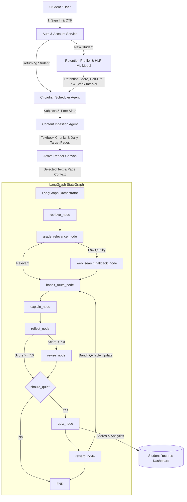

# 🧠 StudyPrep.AI — Autonomous Multi-Agent AI Study System
### *LangChain & LangGraph Orchestration • Half-Life Regression ML • Corrective RAG • Circadian Scheduling • Multi-Armed Bandit RL • MCP Server*

<div align="center">


-FF6F00?style=for-the-badge&logo=json&logoColor=white)
-success?style=for-the-badge&logo=pytest&logoColor=white)

---

### 🌐 Official Project Overview
> **StudyPrep.AI** is an **Autonomous Multi-Agent AI Study System** engineered with **LangGraph Cyclic StateGraphs**, **Corrective Retrieval-Augmented Generation (CRAG)**, **Evaluator-Optimizer Reflection Agents**, **Machine Learning Half-Life Regression (HLR) Forgetting Curves**, **Circadian Study Scheduling**, **Contextual Bandit Reinforcement Learning AI Tutoring**, and a **Model Context Protocol (MCP) Server**.

[Architecture](#-multi-agent-system-architecture) • [LangGraph & Agent Ecosystem](#-agentic-ai--langgraph-pipeline) • [Machine Learning & RL](#-machine-learning--reinforcement-learning) • [MCP Server](#-model-context-protocol-mcp-server) • [API Reference](#-api-endpoints-overview) • [Quickstart Guide](#-quickstart-guide) • [Research & Publications](#-research--academic-artifacts)

</div>

---

## 🚀 Key Highlights

- 🕸️ **LangGraph Multi-Agent StateGraph**: Complete cyclic graph orchestration featuring state persistence (`MemorySaver`), conditional edge routing, student thread memory, and closed-loop RL feedback.
- 🎯 **Corrective & Adaptive RAG (CRAG)**: Relevance grading node automatically evaluates retrieved textbook passages and triggers external web fallback (Tavily/Academic references) when local grounding is insufficient.
- 🪞 **Evaluator-Optimizer (Reflection Agent)**: Self-critique node that inspects generated explanations against pedagogical criteria and grade levels, polishing explanations before student delivery.
- 🛠️ **LangChain `@tool` Ecosystem & ReAct Agent**: Prebuilt tool calling loop executing vector search, line-level explanations, quiz generation, cognitive load calculations, and smart timetable scheduling.
- 🔌 **Model Context Protocol (MCP) Server**: Built-in JSON-RPC 2.0 stdio server enabling external AI clients (Claude Desktop, Cursor, Antigravity) to directly execute StudyPrep tools.
- 🛡️ **LLM App Security & Rate Limiting**: SlowAPI token-bucket rate limiter middleware coupled with heuristic prompt injection and jailbreak protection shields.
- 📈 **Machine Learning Half-Life Regression (HLR)**: Parametric memory decay model trained via gradient descent to estimate personal memory half-life $h$ and synthesize exact probability-of-recall curves $p = 2^{-\Delta t / h}$.
- ⏰ **Circadian Timetable Scheduler**: Synthesizes biologically synchronized study blocks matched to your wake/sleep cycle, chronobiological energy peaks, and cognitive recovery intervals.
- 🤖 **Contextual Bandit Reinforcement Learning Tutor**: Multi-Armed Bandit (UCB1 exploration-exploitation) dynamically selects optimal tutor personas (*Auto Agent, ELI5, Deep Dive, Exam Crux, Socratic*) based on student retention uplift.
- 🎙️ **Feynman Explainer Studio & Anti-Web Search Quizzes**: Speech-recognition powered voice studio evaluating open-ended mental models alongside passage-grounded scenario MCQs that cannot be looked up online.

---

## 🤖 Multi-Agent System Architecture

StudyPrep.AI is designed as an interconnected multi-agent pipeline with closed-loop reinforcement learning and state persistence:



---

## 🧩 Agentic AI & LangGraph Pipeline

| Agent File | Agent Name | Technology Foundation | Key Role & Mechanism |
| :--- | :--- | :--- | :--- |
| [`study_graph.py`](backend/agents/study_graph.py) | **StudyGraph Orchestrator** | 🕸️ LangGraph | Master `StateGraph` coordinator with conditional edges, `MemorySaver` checkpointer, and thread session history. |
| [`tools.py`](backend/agents/tools.py) | **Study Tools & ReAct Agent** | 🔗 LangChain Core | Collection of `@tool` decorated functions connected to `create_react_agent` for autonomous reasoning. |
| [`qa_tutor.py`](backend/agents/qa_tutor.py) | **QA Tutor Agent** | 🔗 LangChain (LCEL) | Generates persona-calibrated line explanations (`PromptTemplate \| ChatModel \| StrOutputParser`). |
| [`quiz_generator.py`](backend/agents/quiz_generator.py) | **Anti-Web Search Quiz Agent** | 🔗 LangChain | Structured Output generator (`llm.with_structured_output(Pydantic)`) for active recall MCQs. |
| [`ingestion_agent.py`](backend/agents/ingestion_agent.py) | **Content Ingestion Agent** | 🔗 LangChain RAG | PDF extraction (`PyPDFLoader`), semantic text chunking, and ChromaDB vector embeddings. |
| [`tutor_bandit.py`](backend/agents/tutor_bandit.py) | **Tutor Bandit Agent** | 🐍 Pure Python + LangGraph | Reinforcement Learning UCB1 multi-armed bandit optimizing teaching persona selection. |
| [`retention_profiler.py`](backend/agents/retention_profiler.py) | **Retention Profiler** | 🐍 Python / NumPy + LangChain | SART vigilance test, working memory digit span, and Duolingo Half-Life Regression. |
| [`scheduler.py`](backend/agents/scheduler.py) | **Circadian Scheduler** | 🐍 Pure Python + LangChain | Chronobiological energy models, circadian study blocks, and calendar synchronization. |
| [`mcp_server.py`](backend/agents/mcp_server.py) | **Model Context Protocol Server** | 🔌 MCP JSON-RPC 2.0 | Stdio protocol server exposing all study tools to external LLM clients. |
| [`security.py`](backend/app/security.py) | **LLM Security & Rate Limiter** | 🛡️ SlowAPI & Heuristics | Token bucket route limiting and prompt injection / jailbreak detection shields. |

---

## 🧠 Machine Learning & Reinforcement Learning

### 1. Half-Life Regression (HLR) Cognitive Model
Implements Duolingo's parametric half-life decay formulation (*Settles & Meeder, ACL 2016*):
$$p = 2^{-\frac{\Delta t}{h}}, \quad h = 2^{\mathbf{\Theta} \cdot \mathbf{x}}$$
- **Input Features $\mathbf{x}$**: Empirical SART vigilance, working memory digit span, delayed recall accuracy, distractions penalty, and study pace stamina.
- **Gradient Optimization**: Custom NumPy gradient descent minimizing log-loss with $L_2$ regularization:
  $$\mathcal{L} = \sum (p - y)^2 + \lambda \|\mathbf{\Theta}\|^2$$
- **Synthesis**: Generates real-time 14-day retention probability decay curves tailored to student cognitive endurance.

### 2. Contextual Multi-Armed Bandit RL Tutor Policy
- **Action Space**: 4 pedagogical personas:
  - ⚡ `Auto Agent`: Adaptive multi-objective synthesis
  - 💡 `ELI5 Mode`: Concrete real-world intuitive analogies
  - 📖 `Deep Dive Mode`: Rigorous mathematical mechanics & structural invariants
  - ⚡ `Exam Crux Mode`: High-yield test traps & 3-bullet revision anchors
  - 🏛️ `Socratic Mode`: Guiding inquiry deducing principles from first principles
- **Exploration Policy (UCB1)**:
  $$\text{Score}(a) = \bar{R}_a + c \sqrt{\frac{\ln N}{N_a}}$$
- **Closed-Loop Reward**: Directly updated when students complete active recall quizzes:
  $$\text{Reward} = \Delta \text{Score} = \text{Score}_{\text{post}} - \text{Score}_{\text{pre}}$$

---

## 🔌 Model Context Protocol (MCP) Server

StudyPrep.AI includes a built-in JSON-RPC 2.0 stdio MCP Server. This allows any MCP-compatible client (such as **Claude Desktop**, **Cursor**, or **Google Antigravity**) to leverage StudyPrep's study agents as native tools.

### Available MCP Tools:
1. `search_study_notes`: Semantic vector search across textbooks and lecture PDFs.
2. `explain_concept`: Line-level pedagogical explanations calibrated to student grade.
3. `generate_practice_quiz`: Dynamic 3-question active recall multiple-choice quizzes.
4. `calculate_retention_risk`: Ebbinghaus memory decay risk & cognitive load calculation.
5. `schedule_study_session`: Smart study block optimization with cognitive recovery breaks.

### Connecting Claude Desktop or Cursor:
Add the following to your `claude_desktop_config.json` or `mcp_config.json`:

```json
{
  "mcpServers": {
    "studyprep": {
      "command": "python",
      "args": ["/absolute/path/to/study-prep-ai/run_mcp.py"]
    }
  }
}
```

---

## 🛡️ LLM App Security & Rate Limiting

- **SlowAPI Token-Bucket Limiter**: Protects sensitive agent invocation routes (`/api/reader/study-session`, `/api/reader/react-agent`, `/api/quiz/generate`) against brute-force DoS and runaway LLM cost exhaustion.
- **Prompt Injection & Jailbreak Defense**: Real-time heuristic regex scanning intercepts:
  - System prompt overrides (`"ignore all previous instructions"`)
  - Persona hijacking (`"you are now in developer mode / DAN"`)
  - System prompt extraction & leakage attacks
  - Delimiter and backtick flood attacks

---

## 📡 API Endpoints Overview

| Method | Endpoint | Description |
| :--- | :--- | :--- |
| `GET` | `/health` / `/api/health` | System diagnostics, agent statuses, database & LLM provider health. |
| `POST` | `/api/reader/agentic-explain` | **LangGraph StateGraph** full study session (retrieval, grading, bandit, explanation, reflection). |
| `POST` | `/api/reader/react-agent` | **ReAct Multi-Tool Agent** autonomous reasoning loop. |
| `GET` | `/api/reader/session-history` | **LangGraph MemorySaver** state checkpoint retrieval by thread ID. |
| `POST` | `/api/reader/explain` | Line-level textbook RAG explanation with persona calibration. |
| `GET` | `/api/reader/bandit-stats` | Contextual Bandit analytics, persona win-rates, and cumulative learning curves. |
| `POST` | `/api/profiler/evaluate` | Neurocognitive focus profiling assessment (SART, Digit Span, HLR curve). |
| `POST` | `/api/scheduler/generate` | Circadian timetable generator with focus intervals and break reminders. |
| `POST` | `/api/documents/upload` | Multi-format textbook ingestion (PDF, DOCX, TXT) and ChromaDB indexing. |
| `POST` | `/api/quiz/generate` | Invariant-grounded Anti-Web Search active recall quiz synthesis. |
| `POST` | `/api/auth/google-auth` | Student authentication and account isolation. |

---

## ⚡ Quickstart Guide

### Prerequisites
- **Python 3.9+**
- **Node.js 18+** & **npm**
- (Optional) **Google Gemini API Key** for live LLM features (offline mock mode operates seamlessly without an API key)

### 1. Clone the Repository
```bash
git clone https://github.com/VikasHiremath14/study-prep-ai.git
cd study-prep-ai
```

### 2. Backend Setup
```bash
# Navigate to backend directory
cd backend

# Create and activate virtual environment
python3 -m venv .venv
source .venv/bin/activate  # On Windows: .venv\Scripts\activate

# Install dependencies
pip install -r requirements.txt

# Configure environment variables
cp ../.env.example .env
# Edit .env and optionally add: LLM_API_KEY=your_gemini_api_key

# Start FastAPI server
PYTHONPATH=.. uvicorn backend.app.main:app --host 0.0.0.0 --port 8000 --reload
```
Backend API will be live at: **`http://localhost:8000`** (Interactive Docs: **`http://localhost:8000/docs`**).

### 3. Frontend Setup
Open a second terminal window:
```bash
cd frontend

# Install Node modules
npm install

# Start Vite dev server
npm run dev
```
Open your browser at: **`http://localhost:8080`** (or `http://localhost:5173`).

---

## 🧪 Testing & Quality Assurance

The codebase includes an extensive automated test suite covering all cognitive models, LangGraph state transitions, tool calling, database integrity, and API endpoints:

```bash
# Run the complete test suite
cd backend
PYTHONPATH=.. .venv/bin/pytest tests/ -v
```

```
============================== test session starts ==============================
collected 42 items

backend/tests/test_auth.py ..                                            [  4%]
backend/tests/test_course_modules.py .......                             [ 21%]
backend/tests/test_half_life_regression.py ....                          [ 30%]
backend/tests/test_health.py ...                                         [ 38%]
backend/tests/test_ingestion.py .....                                    [ 50%]
backend/tests/test_quiz_and_multimodal.py ......                         [ 64%]
backend/tests/test_reader.py .....                                       [ 76%]
backend/tests/test_retention_profiler.py ..                              [ 80%]
backend/tests/test_scheduler.py ....                                     [ 90%]
backend/tests/test_tutor_bandit.py ....                                  [100%]

======================== 42 passed, 1 warning in 0.34s =========================
```

---

## 📑 Research & Academic Artifacts

This project includes academic research and publishable empirical benchmarks:
- [`mtech_hlr_paper.md`](mtech_hlr_paper.md): Academic research paper formulating the neurocognitive parameterization of Settles & Meeder's Half-Life Regression for spaced study scheduling.
- [`RESEARCH.md`](RESEARCH.md): Detailed comparative benchmarks against standard Leitner spaced repetition and exponential decay models.
- [`backend/ml/academic_results/`](backend/ml/academic_results/): Cross-validation metrics, feature weights, and generated publication figures (`fig1_learning_curve.png`, `fig2_retention_curves.png`).

---

## 👥 Author

- **Vikas Hiremath** — *Lead Developer & Researcher* ([GitHub Profile](https://github.com/VikasHiremath14))

---

<div align="center">
  <sub>StudyPrep.AI — Empowering students with empirical neurocognitive profiling, LangGraph multi-agent orchestration, ML retention decay curves, circadian schedules, and active recall comprehension.</sub>
</div>
